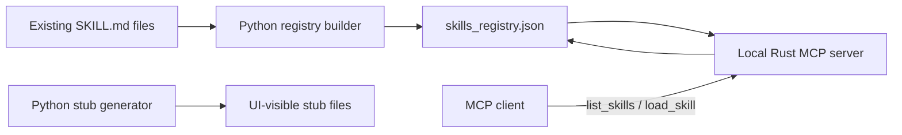

<div align="center">

# Antigravity Skill Injector

**Proof-of-concept for loading skill documents on demand through a local Rust MCP server**

[](https://www.rust-lang.org)
[](https://www.python.org)
[](LICENSE)

</div>

## Scope

This repository explores replacing full local `SKILL.md` documents with small UI-visible stubs while serving the original skill content from a local JSON registry through MCP tools.

It contains:

- a small Rust JSON-RPC/MCP server with `list_skills` and `load_skill` tools
- a Python migration script that extracts skill metadata and content into a registry
- a Python stub generator
- an interactive shell installer that builds the server and prints the configuration block to add manually

## Current status and limits

- Proof-of-concept, not a supported Antigravity extension or production package.
- CI checks that the Rust server compiles, the Python scripts parse, and the shell installer is syntactically valid.
- No automated integration test currently launches the Antigravity desktop application.
- Token usage has not been benchmarked, so this repository makes no percentage-saving or “zero overhead” claim.
- Stub size varies with skill names and descriptions; it is not guaranteed to be a fixed token count.
- The migration process writes generated files. Back up the source skill directory and inspect the output before replacing an existing setup.

## Architecture



## Setup

Requirements:

- Rust toolchain supporting edition 2024
- Python 3.9+
- an MCP-capable local client

```bash
git clone https://github.com/pappdavid/antigravity-skill-injector.git
cd antigravity-skill-injector
./install.sh
```

The installer:

1. builds the Rust server in release mode
2. creates local data/config directories
3. optionally migrates an existing skills directory into `skills_registry.json`
4. generates stub files
5. prints an MCP configuration block for manual installation

The server accepts the registry path as its first command-line argument. The generated configuration uses that explicit path.

Example configuration shape:

```json
{
  "mcpServers": {
    "skill-injector": {
      "command": "/absolute/path/to/mcp-skill-injector",
      "args": ["/absolute/path/to/skills_registry.json"]
    }
  }
}
```

Exact configuration locations and compatibility may vary by client version.

## MCP tools

- `list_skills`: lists registry entries and descriptions
- `load_skill`: returns the stored instructions and optional schema for one skill ID

## Verification

```bash
cargo check --manifest-path src/mcp-server/Cargo.toml
python3 -m py_compile scripts/migrate_skills.py scripts/generate_stubs.py
bash -n install.sh
```
