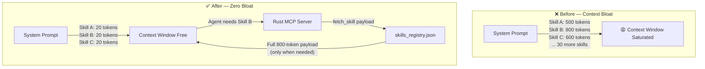
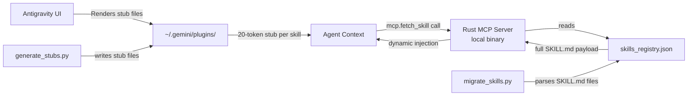

<div align="center">

# Antigravity Skill Injector

**Zero-context-bloat dynamic skill loading for the Antigravity Desktop App**

[](https://www.rust-lang.org)
[](https://www.python.org)
[](https://modelcontextprotocol.io)
[](https://antigravity.so)
[](LICENSE)

</div>

---

## The Problem

Antigravity loads every skill into the system prompt at conversation start. With dozens of skills, that's **thousands of wasted tokens** before you write a single word — context bloat, slower responses, and higher cost on every turn.

## The Solution

Replace heavy `SKILL.md` files with **20-token stubs**. Skills still appear in the Antigravity UI with real names and descriptions. When the agent actually needs a skill, it calls the local Rust MCP server to fetch the full payload **on demand**.

---

## How It Works



---

## Architecture



---

## Setup

### 1. Clone and install

```bash
git clone https://github.com/pappdavid/antigravity-skill-injector.git
cd antigravity-skill-injector
./install.sh
```

The installer will:
- Compile the Rust MCP server (requires Rust 1.75+)
- Ask for your existing Antigravity skills directory
- Migrate all `SKILL.md` files to `skills_registry.json`
- Generate 20-token stub files in your Antigravity plugins directory

### 2. Configure Antigravity

The installer prints an MCP config block. Add it to `~/.gemini/config/mcp_config.json`:

```json
{
  "mcpServers": {
    "skill-injector": {
      "command": "/path/to/antigravity-skill-injector/src/mcp-server/target/release/skill-injector-mcp",
      "args": ["--registry", "/path/to/skills_registry.json"]
    }
  }
}
```

### 3. Restart Antigravity

All your skills appear in the UI with zero token overhead. The agent fetches full payloads on demand.

---

## Components

| Component | Language | Description |
|---|---|---|
| `src/mcp-server/` | **Rust** | Ultra-fast local MCP server — JSON-RPC over stdio |
| `scripts/migrate_skills.py` | **Python** | Parses `SKILL.md` YAML frontmatter → `skills_registry.json` |
| `scripts/generate_stubs.py` | **Python** | Generates 20-token stub files for the Antigravity UI |
| `install.sh` | **Bash** | End-to-end installer: compile → migrate → inject → configure |

---

## Token Savings

```
Typical setup: 30 skills × 600 tokens average = 18,000 tokens/conversation
After injection: 30 skills × 20 tokens = 600 tokens/conversation

Savings: ~17,400 tokens per conversation (~97% reduction)
```

---

## Tech Stack

<div align="center">

&nbsp;
&nbsp;


</div>
